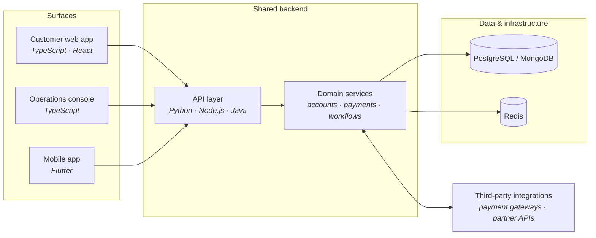

<a href="https://www.monkdevelopers.com">
  <picture>
    <source media="(prefers-color-scheme: dark)" srcset="./assets/banner-dark.svg">
    <source media="(prefers-color-scheme: light)" srcset="./assets/banner-light.svg">
    
  </picture>
</a>

  I build software products end-to-end — fintech, commerce, and internal operations. Concept to launch, and beyond.

| **150+** | **98%** | **5+** | **12+** |
| :---: | :---: | :---: | :---: |
| projects delivered | client satisfaction | years shipping products | countries with clients |

  
  
  

---

### What I do

I lead a team that takes products from a blank page to production — architecture, build, launch, and the unglamorous work of keeping them running afterward.

Most of my time goes to **regulated and operationally heavy products**: platforms that move money, manage compliance, or run a business's internal workflow. The kind where correctness matters more than novelty.

- **Product engineering** — web, mobile, and backend as one system, not three handoffs
- **Platform architecture** — multi-surface products sharing a backend, built to survive their own growth
- **Operations software** — CRMs, ERPs, and internal tooling that replace spreadsheets
- **Idea to launch** — scoping, technical direction, and delivery for founders without an in-house team

---

### How I build

Almost everything I ship has the same shape: several surfaces for different people, one backend that owns the rules, and the data and integrations behind it.

**One backend, many surfaces.** Customer app, ops console and mobile client all run on the same rules. Business logic lives in one place. 
**Correctness over novelty.** In money-moving systems the boring path — explicit state, audit trails, reconciliation — is the right one. 
**Own it after launch.** Monitoring, fixes and iteration are part of the product, not a follow-up contract.

---

### Team activity

<picture>
  <source media="(prefers-color-scheme: dark)" srcset="https://raw.githubusercontent.com/Satyajit-Codys/Satyajit-Codys/output/stats-dark.svg">
  <source media="(prefers-color-scheme: light)" srcset="https://raw.githubusercontent.com/Satyajit-Codys/Satyajit-Codys/output/stats-light.svg">
  
</picture>

And my own contribution graph:

<picture>
  <source media="(prefers-color-scheme: dark)" srcset="https://raw.githubusercontent.com/Satyajit-Codys/Satyajit-Codys/output/contrib-dark.svg">
  <source media="(prefers-color-scheme: light)" srcset="https://raw.githubusercontent.com/Satyajit-Codys/Satyajit-Codys/output/contrib-light.svg">
  
</picture>

Generated daily by a <a href="./.github/workflows/profile-assets.yml">GitHub Actions workflow</a> straight from the GitHub API. Client work is under NDA, so only aggregate numbers are shown — no repository names.

---

### Founders' Grant

> [!TIP]
> **One project a month. Completely free.**

Every month, my team at Monkdevelopers builds one website or app at no cost — start to finish — for someone who needs it but can't afford agency rates. Same engineers, same process as our client work.

It's for you if:

- You're a small business, a non-profit, or an early founder with a real need
- A website or app would meaningfully move your work forward
- Paying agency rates right now genuinely isn't an option
- You can tell us what you need and why it matters

Applications take about five minutes. Every one gets read by the team — we're looking for real impact and genuine need, not polish. We pick one project each month, and applications we don't select stay on file.

**[Apply for the Founders' Grant →](https://www.monkdevelopers.com/founders-grant)**

---

### Stack

  &nbsp;&nbsp;&nbsp;&nbsp;
  &nbsp;&nbsp;&nbsp;&nbsp;
  &nbsp;&nbsp;&nbsp;&nbsp;
  &nbsp;&nbsp;&nbsp;&nbsp;
  &nbsp;&nbsp;&nbsp;&nbsp;
  &nbsp;&nbsp;&nbsp;&nbsp;
  

  &nbsp;&nbsp;&nbsp;&nbsp;
  &nbsp;&nbsp;&nbsp;&nbsp;
  &nbsp;&nbsp;&nbsp;&nbsp;
  &nbsp;&nbsp;&nbsp;&nbsp;
  <picture><source media="(prefers-color-scheme: dark)" srcset="./assets/aws-dark.svg"></picture>&nbsp;&nbsp;&nbsp;&nbsp;
  

---

### Let's talk

**Currently taking on new projects at Monkdevelopers.**

Reach out if you're building something in fintech, commerce, or operations — or if you have a product that needs a team to carry it from idea to launch. I'm also happy to talk architecture with other founders and engineers, no pitch involved.

  &nbsp;&nbsp;&nbsp;&nbsp;&nbsp;
  &nbsp;&nbsp;&nbsp;&nbsp;&nbsp;
  

